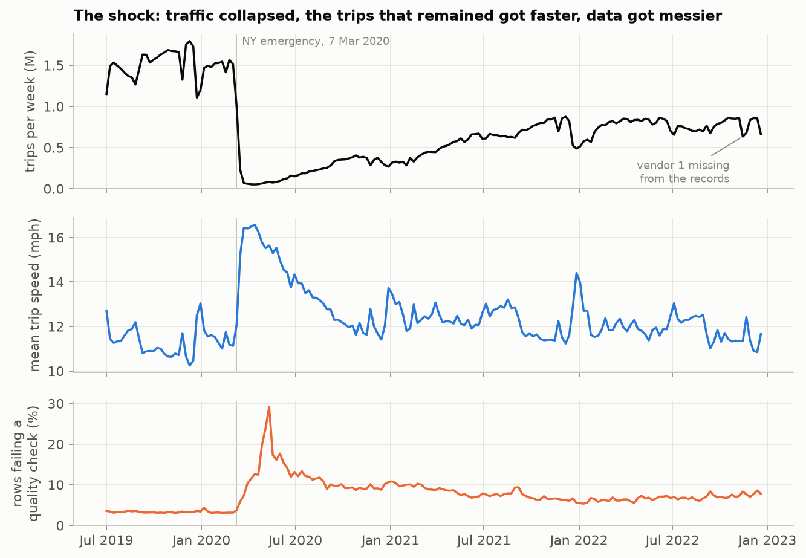
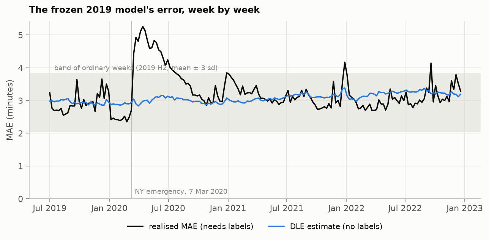
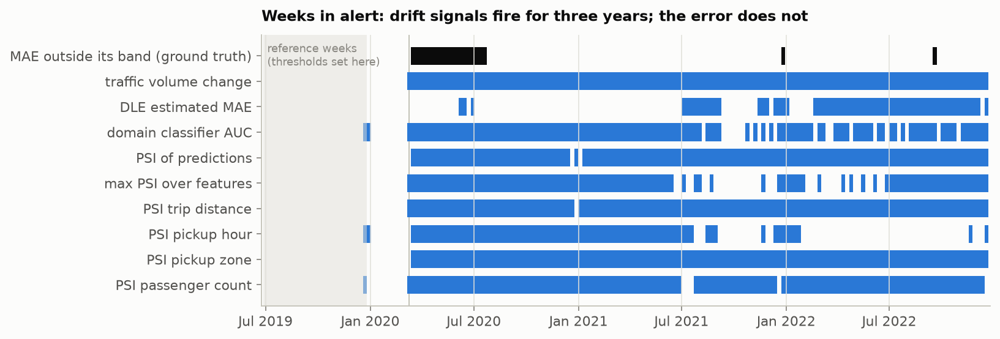
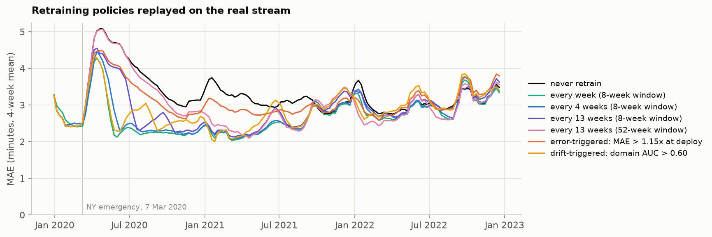

# nyc-taxi-model-monitoring

[](https://github.com/hoang-stack/nyc-taxi-model-monitoring/actions/workflows/ci.yml)


**What would have told you that your model broke?** This repo trains a trip-duration (ETA)
model on NYC yellow-taxi trips from early 2019, freezes it, and replays three years of real
traffic through it, including the COVID-19 shock of March 2020. Every week it logs the model's
real error next to the usual monitoring signals: feature drift (PSI, KS, Jensen-Shannon),
multivariate drift (a domain classifier), prediction drift, and a label-free estimate of the
error (direct loss estimation). It then asks which of those signals would have told an on-call
engineer that the error had changed, early and without false alarms, and replays seven
retraining policies on the same stream.

The same monitoring runs in production form: a FastAPI service with schema validation,
Prometheus metrics (including live PSI per feature), prediction and feedback logs, a batch
monitoring job that exits non-zero on alerts, a file-based model registry with atomic
promote and rollback, and a Docker image that CI builds and smoke-tests.

## Results

### What happened



Weekly yellow-taxi traffic fell from about 1.5 million trips (2019 H2) to 52,000 in the week
of 13 April 2020, and was still about half of the 2019 level in 2022. The trips that remained
were much faster: 16.6 mph in mid-April 2020, against 10.2 to 12.7 mph in every week of
2019 H2. Data quality got worse as well. The share of records failing a check went from 3.2%
in 2019 to 10.3% in 2020, and peaked at 29% in mid-May 2020, when a quarter of all records had
no passenger count and no rate code.



The frozen model's error (MAE) stayed inside its 2019 band for most of the three years. It
left the band in 21 of 156 monitored weeks:

- 19 consecutive weeks of lockdown, from 16 March to 20 July 2020. MAE peaked at 5.26 minutes
  against 2.94 in 2019 H2, and almost all of it was bias: the model expected 2019 traffic, so
  it predicted trips 4.7 minutes longer than they were.
- The week of 27 December 2021, during the Omicron wave, which was faster than any week of
  2019 H2.
- The week of 19 September 2022, which went the other way: trips 2.5 minutes *slower* than
  predicted. It coincides with the UN General Assembly's general debate (20 to 26 September,
  the first fully in-person one since the pandemic), a week known for street closures in
  Manhattan. The cause was not verified.

### Which signals would have told you



Each signal was scored on the 156 monitored weeks, with its alert threshold set from the 26
reference weeks. Average precision is threshold-free: it measures how well the signal ranks
the 21 bad weeks above the others, where random ranking scores 0.135. All signals are in
[results/results.md](results/results.md).

| Signal | Weeks in alert | Precision | Recall | First alert from 9 Mar 2020 | Average precision |
| --- | ---: | ---: | ---: | --- | ---: |
| Traffic volume change | 146 | 0.14 | 1.00 | week of 9 Mar | **0.92** |
| PSI, pickup zone | 145 | 0.14 | 1.00 | week of 16 Mar | **0.91** |
| PSI, drop-off zone | 81 | 0.25 | 0.95 | week of 16 Mar | 0.90 |
| Domain classifier AUC (all features) | 126 | 0.17 | 1.00 | **week of 9 Mar** | 0.77 |
| Max PSI over features | 110 | 0.19 | 1.00 | week of 9 Mar | 0.70 |
| PSI, pickup hour | 85 | 0.24 | 0.95 | week of 16 Mar | 0.38 |
| DLE estimated MAE (label-free) | 63 | 0.08 | 0.24 | week of 8 Jun | 0.16 |
| PSI, trip distance | 145 | 0.14 | 1.00 | week of 9 Mar | 0.13 |
| PSI, predictions | 143 | 0.15 | 1.00 | week of 16 Mar | 0.12 |

The same PSI signals against the textbook cut-offs (0.1 "moderate", 0.25 "major"), which are
fixed in advance:

| Signal | PSI above | Weeks in alert | Precision | Recall | First alert |
| --- | ---: | ---: | ---: | ---: | --- |
| Max PSI over features | 0.25 | 22 | **0.77** | **0.81** | week of 16 Mar 2020 |
| Max PSI over features | 0.1 | 63 | 0.30 | 0.90 | week of 9 Mar 2020 |
| PSI, pickup zone | 0.25 | 15 | 1.00 | 0.71 | week of 23 Mar 2020 |
| PSI, trip distance | 0.1 | 0 | – | 0.00 | never |
| PSI, predictions | 0.1 | 0 | – | 0.00 | never |

### Retraining policies



Seven policies, replayed on the same 156 weeks. Each starts from the 2019 H1 model; a retrain
uses the last 8 (or 52) weeks of labelled trips and serves from the following week.

| Policy | Retrains | Mean weekly MAE | Lockdown (Mar to Jun 2020) | 2022 |
| --- | ---: | ---: | ---: | ---: |
| Every week, 8-week window | 155 | **2.672** | **3.017** | 2.954 |
| Every 4 weeks, 8-week window | 38 | 2.734 | 3.250 | 3.010 |
| Drift-triggered (domain AUC > 0.60), 8-week window | 13 | 2.855 | 3.186 | 3.116 |
| Every 13 weeks, 8-week window | 11 | 2.885 | 3.948 | 3.084 |
| Every 13 weeks, 52-week window | 11 | 3.016 | 4.550 | **2.917** |
| Error-triggered (MAE > 1.15 × MAE at deploy), 8-week window | 1 | 3.089 | 4.049 | 3.127 |
| Never retrain | 0 | 3.269 | 4.566 | 3.065 |

## Study design

- **Data:** [NYC TLC yellow-taxi trip records](https://www.nyc.gov/site/tlc/about/tlc-trip-record-data.page),
  January 2019 to December 2022, a 3% uniform random sample of every month (5.4 million
  trips). The fraction is fixed, not the count, so traffic volume stays visible and a week
  that spans two months is not distorted. Raw files are deleted after sampling.
- **Model:** LightGBM on log trip duration from what is known when a trip is requested:
  pickup and drop-off zone and borough, hour, weekday, planned distance, rate code, vendor,
  passenger count. Fare and drop-off time are not features.
- **Periods, by pickup week:** train 2019 H1 (once, then frozen); **reference** 2019 H2,
  ordinary weeks with labels where every alert threshold and the error-estimation model are
  calibrated; **monitored** 30 Dec 2019 to 25 Dec 2022 (156 weeks).
- **Thresholds:** every signal alerts when it leaves mean + 3 sd of its own values over the
  26 reference weeks, the rule NannyML and most monitoring tools use. None is tuned on the
  monitored period.
- **Ground truth:** a monitored week is *degraded* when the realised MAE leaves its own
  reference band in the same way. Each signal is scored by precision and recall against
  these weeks, by false alarms in the 10 ordinary weeks before the shock, and by how early
  it fired after it.
- **Data quality:** ten checks (nulls, non-positive or sub-minute durations, trips over 3 h,
  zero or > 100-mile distances, speeds over 80 mph, unknown zones, pickups outside the file's
  month). Failing rows are excluded from training and scoring, and the failure rate per week is
  itself monitored.

## What the results say

1. **Drift is the normal state; error changes are rare.** After March 2020 the inputs never
   returned to their 2019 distribution: fewer trips, a different mix of zones and hours. With
   thresholds calibrated on ordinary 2019 weeks, the main drift signals (traffic volume,
   zones, hours, distance, predictions, the domain classifier) alert in 81 to 146 of the 156
   weeks. The error left its band in 21. An on-call rotation paged by these rules would
   have learned to ignore them within a month.
2. **The information is in the signals; the thresholds are wrong.** The same signals, as
   rankings, separate bad weeks from good ones very well. Traffic volume (average precision
   0.92) and the pickup-zone PSI (0.91) put almost all 21 bad weeks first. A band calibrated on
   26 quiet weeks is simply too narrow: the pickup-zone PSI never exceeded 0.025 in 2019 H2,
   sat around 0.05 (median) in the monitored weeks where the error was normal, and reached 0.44 (median) in bad weeks.
   The textbook PSI cut-off of 0.25, applied to the largest feature PSI, gets precision 0.77
   and recall 0.81 with no tuning.
3. **The model's own outputs said nothing.** The PSI of the predictions and of trip distance
   never reached 0.1, not even in April 2020. The trips that remained looked much like
   ordinary trips; what changed was how fast they went, and speed is not an input. Watching
   prediction drift alone, a common recommendation, would have stayed silent through the
   largest shock in the data.
4. **Label-free performance estimation missed the shock completely.** Direct loss estimation
   predicted an MAE between 2.83 and 3.15 throughout the lockdown, while the real MAE was 3.9
   to 5.3. DLE learns which *inputs* make errors large; a change in the input-to-duration relation
   (concept drift: same trip, different speed) is invisible to it by construction. Its average
   precision (0.16) is barely above random. It is the right tool for covariate shift, but it
   gives no protection here.
5. **The multivariate detector was first.** The domain-classifier AUC crossed its threshold
   in the week of 9 March 2020, one week before the error left its band, when the MAE was still
   2.71. It also tracks severity (Spearman 0.76 with the weekly MAE).
6. **Drift monitoring's best catches were data incidents, not model failures.**
   - In the week of 14 November 2022, vendor 1 (about 28% of trips) is almost absent from the
     records: 12 sampled trips instead of about 7,300. The vendor PSI jumped to 2.5 and the
     domain AUC to 0.73, the highest of that year, while the model's error stayed normal.
   - On 17 and 18 September 2022 most records are missing, with 124 sampled trips on the 18th
     instead of about 3,000.

   Both are pipeline problems that would corrupt any dashboard built on this data, and only
   the drift signals saw them.
7. **Batch size changes what a PSI value means.** For a feature with about 250 categories (the
   zones), PSI from sampling noise alone is about 0.08 in a batch of 1,400 trips (the lockdown weeks of this 3%
   sample), against 0.003 in a batch of 45,000. The 0.6 to 0.7 observed during lockdown is
   real drift, but a band calibrated on 45,000-trip weeks is below the noise floor of a small
   week. PSI thresholds need to depend on the batch size, or batches need a minimum size.

8. **Retraining on a schedule beat every clever trigger.** Retraining every week on the last
   8 weeks lowers the mean weekly MAE by 18% (3.27 to 2.67 minutes) and by a third during the
   lockdown (4.57 to 3.02). Every 4 weeks gets most of that gain with a quarter of the
   retrains. When labels arrive within minutes and a retrain takes seconds, a schedule is the
   simple answer.
9. **The drift trigger reacted fast and retrained on broken data.** With 13 retrains it beats
   the 13-week schedule (11 retrains) mainly by retraining right away in March 2020 (lockdown
   MAE 3.19 against 3.95). But it also fired after the two data incidents and retrained on
   them: on the week with most of vendor 1's records missing, and on the week with two
   missing days. A drift trigger needs a data-quality gate in front of it.
10. **An error trigger anchored to one week got stuck.** Its baseline is the MAE of a model's
    first week in service. For the original model that was a holiday week (3.27, higher than
    usual), so the trigger fired only in the week of 16 March 2020. The new model's first week
    fell in the middle of the shock (MAE 4.39), so the baseline became so high that the
    trigger never fired again. Mean MAE was 3.09, barely better than never retraining. Compare
    against a fixed band, or against the retrained model's held-out error, not against one
    noisy week.
11. **Window length is a trade-off between adapting fast and learning from more data.** A
    52-week window is nearly as bad as no retraining during the lockdown (it keeps learning
    2019 traffic), but it is the best policy in 2022, once the new regime had settled.

## Run it

```bash
git clone https://github.com/hoang-stack/nyc-taxi-model-monitoring.git
cd nyc-taxi-model-monitoring
python -m venv .venv && source .venv/bin/activate
pip install -e ".[dev]"
pytest                          # drift statistics vs scipy/sklearn, service, registry, monitor

taximon download                # 48 monthly files, ~2.5 GB streamed, 170 MB kept
taximon study                   # frozen model + every weekly signal  -> results/weekly.csv
taximon policies                # retraining replay (slowest step)    -> results/policies_weekly.csv
taximon report                  # figures + results/results.md
```

### Serve and monitor

```bash
taximon train --start 2022-07-04 --end 2022-12-19 --version v2022h2 --promote
taximon serve                   # or: docker compose up  (API on :8000, Prometheus on :9090)

curl -X POST localhost:8000/predict -H 'content-type: application/json' \
  -d '{"pickup_datetime": "2022-12-01T08:30", "pu_location_id": 132,
       "do_location_id": 230, "trip_distance": 17.2}'
# {"request_id": "...", "eta_minutes": ..., "model_version": "v2022h2"}

curl -X POST localhost:8000/feedback -H 'content-type: application/json' \
  -d '{"request_id": "...", "actual_minutes": 52.0}'

taximon monitor                 # drift + realised MAE over logs/, exit code 1 on alert
taximon versions                # registry; `taximon promote <version>` rolls back
```

The image installs only what serving needs. The model is mounted, not baked in, so promoting
or rolling back a model does not need a rebuild. `python -m taximon.synthetic` writes a small
demo model trained on synthetic trips, which CI uses to build the image and smoke-test it.
[deploy/alerts.yml](deploy/alerts.yml) has Prometheus alert rules for feature drift,
prediction drift and latency.

## Project layout

```text
src/taximon/
├── download.py      monthly TLC files -> fixed-fraction samples
├── data.py          loading, ten data-quality checks, features, weekly batches
├── model.py         the monitored LightGBM ETA model (save / load)
├── drift.py         PSI, KS, Jensen-Shannon, domain-classifier AUC, AUC, thresholds
├── performance.py   realised MAE / MAPE / bias, direct loss estimation (DLE)
├── study.py         the frozen-model study and the policy replay driver
├── evaluate.py      scoring signals against real error changes
├── policies.py      retraining policies replayed on the weekly stream
├── report.py        figures and results/results.md
├── profile.py       reference profile shipped with each model (for live PSI)
├── registry.py      models/<version> + atomic `current` symlink
├── service.py       FastAPI app: /predict /feedback /metrics /health, JSONL logs
├── monitor_logs.py  batch monitoring job over the service logs
├── synthetic.py     synthetic trips for tests and the demo model
└── cli.py           `taximon ...`
deploy/              Prometheus scrape config and alert rules
```

## Limitations

- **A 3% sample.** Weekly batches hold 1,371 to 52,073 trips instead of the full volume; drift
  statistics on full data would be less noisy (point 7).
- **One model, one city, one shock.** COVID-19 was an unusually large, abrupt and lasting
  change. The ranking of signals could differ for slow drift.
- **The ground truth is itself a rule** (MAE outside mean ± 3 sd of 26 reference weeks).
  Other definitions of "degraded", such as a relative MAE increase, would move the precision and
  recall figures but not the main conclusions: drift signals fire constantly, and DLE and
  prediction PSI do not react to the shock.
- **Labels are cheap here.** A trip's duration is known when it ends, so realised MAE is the
  best monitor for this model. Drift signals matter most where labels arrive late (credit,
  churn, fraud). This study measures the drift signals as if labels were not available.
- **Rows that fail a data-quality check are excluded** from training and scoring. In
  production, the API's defaults (passenger count 1, rate code 1) would silently fill the
  gaps that affected up to a quarter of the records in May 2020.
- **The DLE error model** is a single LightGBM fitted on half the reference rows; other loss
  estimators (or NannyML's own implementation) might behave differently on covariate shift.
  They share the same blind spot for concept drift.

## References

- NYC Taxi & Limousine Commission. TLC Trip Record Data.
- Rabanser, S., Günnemann, S., Lipton, Z. (2019). Failing loudly: an empirical study of methods for detecting dataset shift. *NeurIPS.*
- Lipton, Z., Wang, Y.-X., Smola, A. (2018). Detecting and correcting for label shift with black box predictors. *ICML.*
- Gama, J. et al. (2014). A survey on concept drift adaptation. *ACM Computing Surveys.*
- NannyML documentation: direct loss estimation and confidence-based performance estimation.
- Yurdakul, B. (2018). Statistical properties of population stability index. *Western Michigan University.*
- Ke, G. et al. (2017). LightGBM: a highly efficient gradient boosting decision tree. *NeurIPS.*
